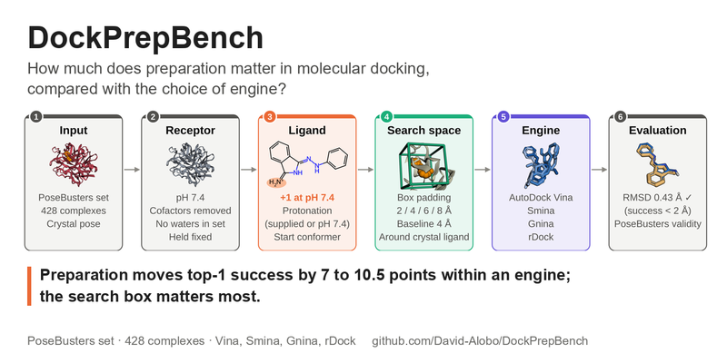
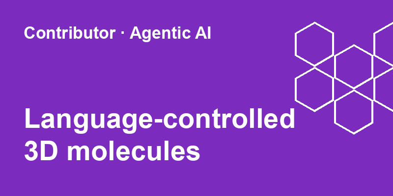
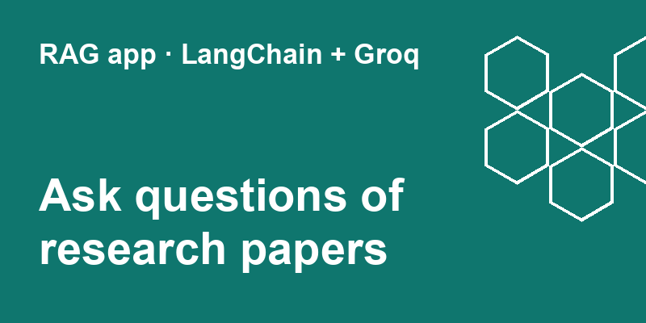
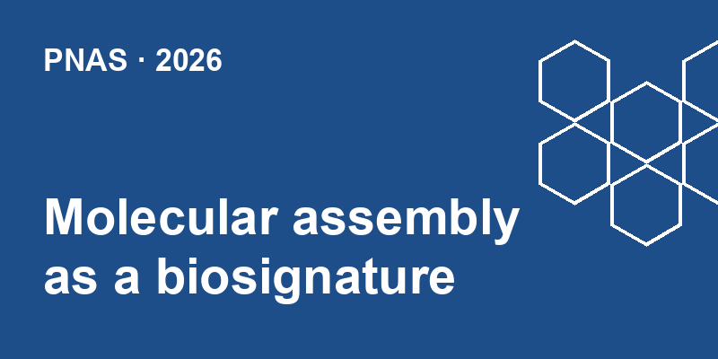
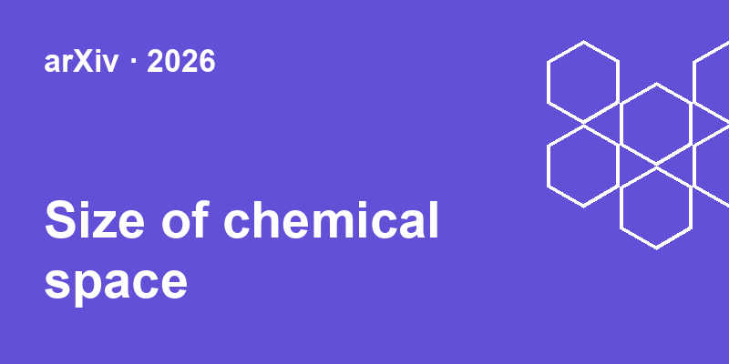
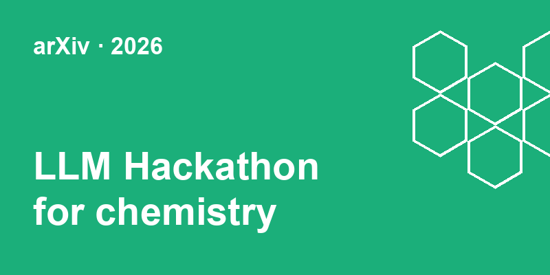
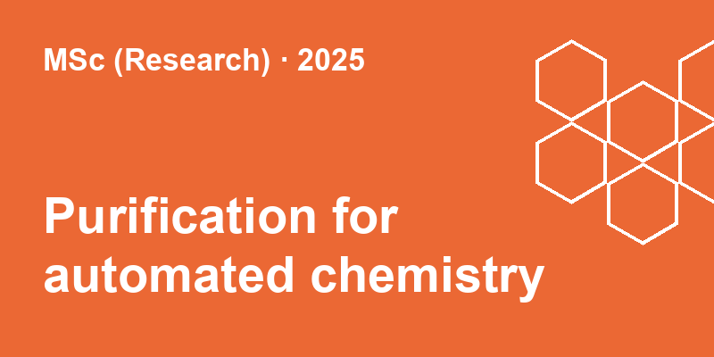

# David Obeh Alobo

**PhD Candidate · Cronin Group · University of Glasgow**

---

## About

My research sits at the intersection of **chemical space exploration** and **chemical synthesis automation**. I build large chemical libraries, tools for exploring chemical space, and reproducible computational methods for drug discovery, and I bring eight years of industry experience in data engineering and analytics to research software.

- **Chemical space exploration:** large chemical libraries, a chemical space explorer, and the size and structure of chemical space through assembly theory
- **Synthesis automation and chemical robotics:** robotic platforms for chemistry, and predicting purification conditions for automated synthesis
- **Computational drug discovery:** molecular docking, structure preparation and reproducible benchmarking

---

## Projects

<table>
  <tr>
    <td width="320" align="center">
      
    </td>
    <td>
      <a href="https://github.com/David-Alobo/DockPrepBench"><b>DockPrepBench</b></a> 
      How much does preparation matter in molecular docking, compared with the choice of engine? One preparation choice at a time, 428 PoseBusters complexes, four engines (Vina, Smina, Gnina, rDock), paired statistics against a seed noise floor.  
      <i>Preparation moves top-1 success by 7 to 10.5 points within an engine; the search box matters most.</i>  
      
      
      
    </td>
  </tr>
  <tr>
    <td width="320" align="center">
      
    </td>
    <td>
      <a href="https://github.com/pagel-s/MIDAS"><b>MIDAS</b></a> (contributor) 
      Molecular Intelligence &amp; Design Articulated by Semantics: an agentic interface for language-controlled 3D molecular generation and manipulation.  
      
      
    </td>
  </tr>
  <tr>
    <td width="320" align="center">
      
    </td>
    <td>
      <a href="https://github.com/David-Alobo/document_question_and_answer"><b>Document Q&amp;A</b></a> 
      Retrieval-augmented question answering over research papers: PDFs are split into chunks, embedded with Sentence Transformers, indexed in FAISS and answered by an LLM through LangChain and Groq, in a Streamlit app.  
      
      
      
      
    </td>
  </tr>
</table>

---

## Publications

<table>
  <tr>
    <td width="320" align="center">
      
    </td>
    <td>
      <a href="https://doi.org/10.1073/pnas.2619198123"><b>Molecular assembly as a universal biosignature measurable by mass spectrometry</b></a> 
      Rutter, Sharma, Seet, <b>Alobo</b>, <i>et al.</i>, Cronin  
      
    </td>
  </tr>
  <tr>
    <td width="320" align="center">
      
    </td>
    <td>
      <a href="https://doi.org/10.48550/arXiv.2606.11486"><b>Elucidating the size of chemical space with assembly theory</b></a> 
      Parra, Patarroyo, Sharma, <b>Alobo</b>, Cronin  
      
    </td>
  </tr>
  <tr>
    <td width="320" align="center">
      
    </td>
    <td>
      <a href="https://doi.org/10.48550/arXiv.2605.03205"><b>From knowledge to action: outcomes of the 2025 LLM Hackathon for Applications in Materials Science and Chemistry</b></a> 
      Roy, Shen, MacBride, <i>et al.</i> (incl. <b>Alobo</b>)  
      
    </td>
  </tr>
  <tr>
    <td width="320" align="center">
      
    </td>
    <td>
      <a href="https://doi.org/10.5525/gla.thesis.85151"><b>The prediction of purification conditions for automated chemistry</b></a> 
      <b>Alobo</b> · MSc (Research) thesis, University of Glasgow  
      
    </td>
  </tr>
</table>

Full list on [ORCID](https://orcid.org/0009-0007-7893-5366).

---

## Technical skills

<b>Cheminformatics and molecular modelling</b>

  
  
  
  
  
  

- Chemical library construction and chemical space analysis
- Molecular docking (Vina, Smina, Gnina, rDock), protein preparation, pose validation
- Protonation and conformer generation

<b>Machine learning, statistics and automation</b>

  
  
  

- Machine learning for chemistry, including prediction of purification conditions
- Paired statistical testing and multiple-comparison correction
- Automated synthesis workflows and chemical robotics

<b>Agentic AI engineering</b>

  
  
  
  
  

- LLM agents with tool use for multi-step scientific workflows, including language-controlled molecular design (MIDAS)
- Retrieval-augmented generation: chunking, embeddings, vector search and grounded answers
- Agent-assisted research software engineering
- Contributor to the 2025 LLM Hackathon for Applications in Materials Science and Chemistry

<b>Data engineering and analytics</b>

  
  
  
  
  
  
  
  
  
  
  
  

- ETL/ELT pipelines orchestrated with Airflow on GCP and AWS
- Large-scale processing with Spark and analytical SQL with DuckDB and BigQuery
- Data warehousing and graph databases for analytics and research data
- Parallel, resumable batch pipelines on multi-GPU Linux servers
- Business intelligence dashboards and reporting

<b>Software engineering and visualisation</b>

  
  
  
  
  
  

- Tested, reproducible research code with continuous integration
- Interactive 3D web tools (three.js, 3Dmol.js) and publication figures (Matplotlib)

---

## Background

I hold an MSc (Research) from the University of Glasgow, an upper second-class degree in Industrial Chemistry from Olabisi Onabanjo University, and am a Udacity Data Analytics alumnus. Before research I spent over eight years in industry across the public and private sectors; I was the first data analyst at Evercare Hospital Lekki, where I used business intelligence and AI to improve patient care.

  <i>Chemical space · Synthesis automation · Data engineering</i>

